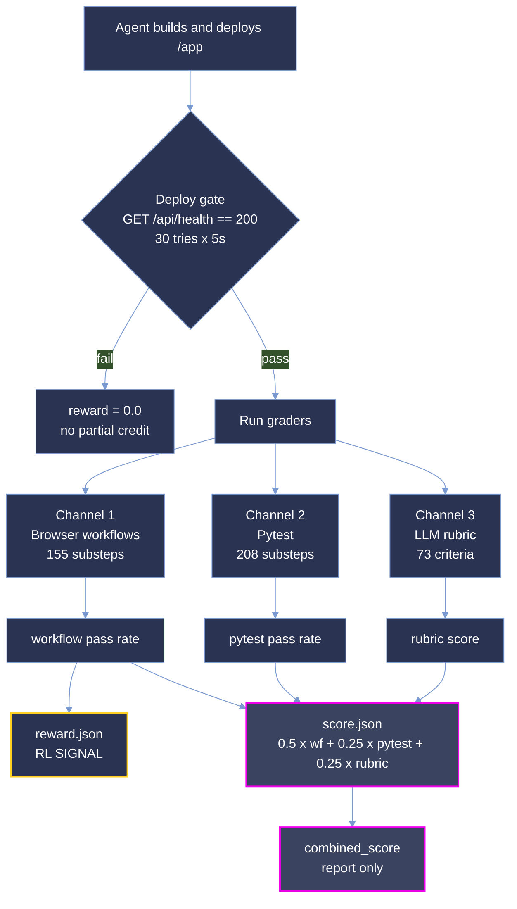

<div align="center">

<strong>Four greenfield application briefs. Forty graded rollouts. No starting codebase.</strong>

<p>


</p>

<sub>
<a href="#summary">Summary</a> ·
<a href="#repository-layout">Layout</a> ·
<a href="#difficulty-tiers">Tiers</a> ·
<a href="#results">Results</a> ·
<a href="#analysis">Analysis</a> ·
<a href="#coverage">Coverage</a> ·
<a href="#dataset-structure">Dataset</a> ·
<a href="#trajectory-structure">Trajectories</a> ·
<a href="#scoring-methodology">Scoring</a> ·
<a href="#reproduction">Reproduction</a> ·
<a href="#verification-and-quality-assurance">Verification</a>
</sub>

</div>

# Deku — Greenfield Application Build Evaluation

**Deku measures whether a coding agent can turn a prose product brief into a deployed, working web application that a stranger can drive in a browser.** There is no repository to patch, no failing test to flip, no oracle diff to approximate. The agent receives a 47–96 KB specification, an empty `/app`, and a service stack, and must ship something that boots, serves an HTTP health endpoint, and survives a live browser walkthrough of its own user flows.

> Every brief in this sample is original. `provenance.yaml` records `origin: original`, `upstream: none`, `derived_from: []` for all four tasks — they are not derived from public pull requests, so no upstream solution exists to be memorized.

## Summary

| Property | Value |
| --- | --- |
| Tasks | 4 |
| Models | 2 (`opus-5`, `anthropic-glm-5.3`) |
| Runs per task per model | 8 |
| Graded rollouts | 40 |
| Languages | Python (1), TypeScript (3) |
| Grader version | 0.22.0 |
| Harbor version | 0.20.0 |
| Reward signal | Workflow pass rate, `reward.json` |
| Specification volume | ~283 KB across 4 briefs |
| Sample size on disk | 24,143 files, 657 MB |

The run grid is deliberately incomplete. `opus-5` ran all four tasks; `glm-5.3` ran only `ebe89438` (community-calendar-hosting). Cross-model comparison is therefore valid on exactly one task.

| Metric | opus-5 (n=32) | glm-5.3 (n=8) |
| --- | ---: | ---: |
| pass@8 (mean reward) | **44.49%** | 32.81% |
| Combined score | 0.5665 | 0.3906 |
| Pytest channel | 0.7487 | 0.4880 |
| Rubric channel | 0.6131 | 0.4183 |
| Rubric coverage | 0.5058 | 0.5278 |
| Mean cost per run | $161.18 | $16.03 |
| Mean requests per run | 1,161 | 958 |

## Repository layout

```
deku-samples/
├── LICENSE
├── README.md
├── 1b21d4ac-055a-52e7-b754-0620f337b0d4/   deku/talent-roster-reel           (python)
├── 63376906-d58e-5ef4-a179-0ee63775b5c0/   deku/mass-balance-attestation     (typescript)
├── e0f889a5-7a3b-5a05-a837-43ac155857a6/   deku/hardware-companion-storefront (typescript)
└── ebe89438-5b13-59d8-8113-c6b0a5e75ff0/   deku/community-calendar-hosting   (typescript)
```

Each task directory is a self-contained bundle: the brief, the environment that hosts it, the reference solution, the grader, and every trajectory recorded against it.

## Difficulty tiers

The shipped `task.toml` files are **uncalibrated** — `difficulty = ""`, `pass_rate = 0.0`, `calibration_trials = 0` on all four. The bands below are derived post hoc from observed `opus-5` pass@8, using the same thresholds as the Argos suite.

| Band | Threshold (pass@8) |
| --- | --- |
| trivial | ≥ 0.875 |
| easy | ≥ 0.500 |
| medium | ≥ 0.375 |
| hard | ≥ 0.250 |
| expert | < 0.250 |

| Task | opus-5 band | glm-5.3 band |
| --- | --- | --- |
| `ebe89438` community-calendar-hosting | easy | hard |
| `1b21d4ac` talent-roster-reel | medium | — |
| `e0f889a5` hardware-companion-storefront | medium | — |
| `63376906` mass-balance-attestation | expert | — |

## Results

### 1. Pass rate by task

| Task | Model | pass@8 | Combined | Pytest | Rubric | σ | Range |
| --- | --- | ---: | ---: | ---: | ---: | ---: | --- |
| `ebe89438` community-calendar-hosting | opus-5 | 85.94% | 0.8125 | 0.9904 | 0.4387 | 0.0605 | 0.750–0.938 |
| `1b21d4ac` talent-roster-reel | opus-5 | 40.38% | 0.5562 | 0.8023 | 0.6150 | 0.1138 | 0.154–0.538 |
| `e0f889a5` hardware-companion-storefront | opus-5 | 37.50% | 0.5407 | 0.6696 | 0.7431 | 0.1036 | 0.188–0.500 |
| `63376906` mass-balance-attestation | opus-5 | 14.13% | 0.3567 | 0.5324 | 0.6118 | 0.0287 | 0.087–0.174 |
| `ebe89438` community-calendar-hosting | glm-5.3 | 32.81% | 0.3906 | 0.4880 | 0.4183 | 0.1868 | 0.188–0.813 |

Difficulty spreads across a 6× range on a single scaffold. `63376906` — the only enterprise task, the only one requiring Keycloak, 23 workflows and 122 substeps of which **85 are marked critical** — never cleared 17.4% in eight attempts, and its σ of 0.0287 says the agent failed in the same place every time. That is a wall, not variance.

### 2. Head-to-head on `ebe89438`

| Metric | opus-5 | glm-5.3 |
| --- | ---: | ---: |
| pass@8 | **85.94%** | 32.81% |
| Combined score | 0.8125 | 0.3906 |
| Pytest channel | 0.9904 | 0.4880 |
| Requests per run | 663 | 958 |
| Cost per run | $178.24 | $16.03 |
| σ across 8 runs | 0.0605 | 0.1868 |

The only task both models attempted separates them by 53 points. `glm-5.3` costs 11× less and reached 0.8125 once — its best run beats `opus-5`'s worst — but its σ is 3× higher, so that peak is not a capability you can schedule. `opus-5` is expensive and boring: eight runs, all between 0.75 and 0.94.

### 3. Cost

| Aggregate | Value |
| --- | ---: |
| Total spend across 40 rollouts | **$5,285.89** |
| Input tokens | 947,968,042 |
| Output tokens | 13,664,332 |
| Cache-read tokens | 1,194,999,363 |
| Requests | 44,812 |
| `opus-5` per-run cost range | $24.50 – $347.17 |

Output is 1.4% of input. These agents are overwhelmingly reading — the brief, their own files, browser state — not writing. The 14× per-run cost spread within a single model is a stronger signal than the mean: the same model on the same task grid can cost $25 or $347 depending on how early it finds its footing.

## Analysis

**No run scored 1.0, and no run scored 0.0.** Across 40 rollouts the corpus has no ceiling effect and no floor effect. Every rollout deployed, every rollout passed some workflows, none passed all of them. The benchmark is live in its useful range.

**The rubric channel is half-blind.** Of 728 rubric verdicts, 234 PASS, 137 FAIL, and **357 INSUFFICIENT_EVIDENCE — 49.0% unresolved**. The causes are instrumentation limits, not model failures: the browser tool cannot emulate `prefers-reduced-motion`, cannot compare hover against no-hover, and screenshot transport compresses frames past the point where a judge can assess visual fidelity. Two runs (`ebe89438` opus run_1 and run_2) had all 18 criteria unresolve, at which point the scorer drops the rubric key from `weights_applied` and renormalizes over the remaining channels.

**Deploy is a cliff, not a slope.** `tests/test.sh` polls `${APP_PUBLIC_URL}/api/health` for HTTP 200, 30 attempts at 5-second intervals, before any grading runs. An app that does not answer that probe scores zero with no partial credit for code that would have worked. All 40 rollouts cleared it.

**The grader distrusts itself by design.** `reward.json` carries only the workflow pass rate. `score.json` computes `0.5·workflow + 0.25·pytest + 0.25·rubric` and labels it *"a report, not a training signal"*. `judge.json` carries an LLM `judge_score` annotated *"Diagnostic only… A judge-only reward is trivially gamed. The binary substep grader owns the RL reward."* Three scores exist; exactly one is allowed to train.

**Quality gates held.** `needs_human_review = 0`, `invalid = []`, and `degraded = []` on all 40 rollouts.

## Coverage

| Axis | Distribution |
| --- | --- |
| Language | typescript 3, python 1 |
| Sub-category | solo_founder 3, enterprise 1 |
| Service profile | P1-db, P2-db-email, P5-db-pay-email, P6-db-auth-email |
| Services | postgres 4, mailpit 3, keycloak 1, killbill 1 |
| Design direction | editorial-serif 3, dense-ops-console 1 |
| Spec sections given | all 10, on all 4 tasks |

Every task ships the full ten-section brief: overview, roles, features, flow, uiux, frontend, techrequirements, datamodel, constraints, contract.

### Full task list

| UUID | Name | Lang | Domain / pattern | Services | Workflows | Substeps | Reqs | Turns | Tokens |
| --- | --- | --- | --- | --- | ---: | ---: | ---: | ---: | ---: |
| `1b21d4ac` | deku/talent-roster-reel | python | content-publishing / directory-matching | postgres | 13 | 93 | 133 | 120 | 4.5M |
| `63376906` | deku/mass-balance-attestation | typescript | supply-chain-inventory / inventory-allocation | postgres, keycloak, mailpit | 23 | 122 | 135 | 200 | 8.0M |
| `e0f889a5` | deku/hardware-companion-storefront | typescript | ecommerce-retail / commerce-checkout | postgres, killbill, mailpit | 16 | 60 | 71 | 200 | 7.5M |
| `ebe89438` | deku/community-calendar-hosting | typescript | events-ticketing / booking-scheduling | postgres, mailpit | 16 | 88 | 126 | 150 | 5.5M |

Totals: **68 workflows**, **363 substeps** (208 pytest, 155 browser), **174 critical**, **465 traced requirements** — every one of which carries a `YES` verdict in `traceability.csv`.

## Dataset structure

```
<task-uuid>/
├── INDEX.json                  run manifest, checksums, exclusion notes
├── task.toml                   schema 1.4 task definition
├── instruction.md              the brief (47–96 KB)
├── environment/
│   ├── Dockerfile
│   ├── docker-compose.yaml
│   ├── postgres-init.sql
│   └── keycloak-realm.json     (63376906 only)
├── solution/
│   ├── app/                    USER_README.md, run.json
│   ├── checklist.md            394–1,517 lines
│   ├── provenance.yaml
│   ├── solve.sh
│   └── trinity/                TRUTH.md, grounding.yaml, if.yaml,
│                               recompute.py, rubrics.json, test_output.py
├── tests/
│   ├── Dockerfile, test.sh, conftest.py
│   ├── workflows.yaml          browser + pytest substeps, cov: requirement IDs
│   ├── rubric.json             LLM-judged criteria
│   ├── code_rubric.json        source-quality criteria
│   ├── if_constraints.json     instruction-following constraints
│   ├── test_<name>.py
│   └── traceability{,-matrix}.{csv,md}
└── trajectories/<model>/run_1…run_8/
```

`instruction.md` is the contract. `workflows.yaml` is the grader. `traceability.csv` is the proof that every clause of the former is reachable by the latter — each row maps a requirement ID to the substeps that exercise it.

## Trajectory structure

```
run_N/
├── reward.json          {"reward": <workflow pass rate>}   ← the RL signal
├── score.json           combined_score + per-channel breakdown (report only)
├── workflows.json       per-workflow, per-substep verdicts
├── manifest.json        trial_id, task_checksum, stage_seconds, agent version, cost
├── usage.json           tokens + cost for agent, browser_grader, rubric_judge
├── review_queue.json
├── harness-debug.log
├── app/                 the application the agent built
├── logs/
│   ├── app_build.log, app_container.log, orchestration.log
│   ├── browser_results.json, pytest_ctrf.json
│   ├── judge.json                   advisory judge_score
│   └── artifacts_manifest.json
├── screenshots/         NN_route_WxH.png at 1920x1200, 768x1024, 390x844
└── trajectory/
    ├── trajectory.json
    └── sessions/<id>/   TASKS.md, agent_state.pkl, conversation_stats.pkl,
                         events/N.json, event_cache/0-25.json
```

The sample carries **788 screenshots** and **18,734 trajectory events** across **39 session directories**. Screenshots are captured at three viewports per route, so responsive criteria are judged from real renders rather than from CSS inspection.

Per-run `traces/`, `services/`, `evidence_bundle.json` and `finance_posted.json` are omitted from this sample. `app/` excludes `node_modules`, build output, and dot-directories.

## Scoring methodology



### Channel 1 — Browser workflows

A workflow passes only when **all** of its substeps pass. `reward` is the fraction of workflows that pass, and it is the only number that trains anything. Substeps declare `kind: browser` or `kind: pytest`, an optional `critical: true`, and a `cov:` list of requirement IDs. 155 of the 363 substeps are driven through a real browser against the running app.

### Channel 2 — Pytest

208 substeps execute as pytest cases inside the verifier container. `test.sh` deliberately omits `set -e`: a failing test is a *score*, not a harness error. The script writes `{"reward": 0.0}` before anything else runs, so every exit path leaves a reward file behind — a missing file raises `RewardFileNotFoundError` and the trial is lost rather than scored zero.

### Channel 3 — LLM rubric

73 criteria across seven dimensions (instruction_following 14, ui_visual 14, functionality 13, ux_flow 10, motion 8, accessibility 7, responsiveness 7), three of them **negative** criteria that penalize behaviour rather than reward it. Verdicts resolve to PASS, FAIL, INSUFFICIENT_EVIDENCE, or EVALUATOR_ERROR. When the whole channel unresolves, `rubric.score` is `null`, the rubric key drops out of `weights_applied`, and `combined_score` renormalizes across the remaining channels.

Two further graders ship with each task but do not feed `reward`: **`code_rubric.json`** (37 source-quality criteria, judged by a pinned model — `claude-sonnet-4-5`, `claude-opus-4-5`, or `claude-sonnet-4-6` depending on task) and **`if_constraints.json`** (58 instruction-following constraints across format, output_shape, negative, scope, tool_use and ordering, evaluated by pytest for 51 of them and by probe for 7).

## Reproduction

Recompute pass@8 for a single task and model:

```python
import json, pathlib

runs = sorted(pathlib.Path(
    "deku-samples/ebe89438-5b13-59d8-8113-c6b0a5e75ff0/"
    "trajectories/opus-5"
).glob("run_*"))

rewards = [json.loads((r / "reward.json").read_text())["reward"] for r in runs]
print(f"n={len(rewards)}  pass@8={sum(rewards)/len(rewards):.4f}")
# -> n=8  pass@8=0.8594
```

Total spend across the sample:

```bash
find deku-samples -name usage.json -print0 \
  | xargs -0 jq -s '[.[] | .. | objects | select(has("cost_usd")) | .cost_usd] | add'
# -> 5285.89
```

Rubric resolution rate:

```bash
find deku-samples -path '*/logs/judge.json' -print0 \
  | xargs -0 jq -r '.criteria[]?.resolution_status' \
  | sort | uniq -c | sort -rn
# -> 357 INSUFFICIENT_EVIDENCE
# -> 234 PASS
# -> 137 FAIL
```

Confirm no rollout was degraded or flagged:

```bash
find deku-samples -name workflows.json -print0 \
  | xargs -0 jq -s '{runs: length,
                     degraded: [.[] | select(.degraded != [])] | length,
                     invalid:  [.[] | select(.invalid  != [])] | length}'
# -> {"runs": 40, "degraded": 0, "invalid": 0}
```

## Verification and quality assurance

**Confirmed clean:**

- All 40 rollouts deployed successfully and cleared the `/api/health` gate.
- `needs_human_review = 0`, `invalid = []`, `degraded = []` on every rollout.
- All 465 traced requirements carry a `YES` verdict in `traceability.csv`.
- All four `provenance.yaml` files record `origin: original`, `upstream: none`, `derived_from: []`.
- Screening atoms (exclusion_matching, near_duplicate, sanitization, empty_submission, provenance_record) marked applicable against `config/exclusion-baseline.yaml`.
- `canary_present = true` on all four tasks.
- No rollout scored 1.0 or 0.0 — no ceiling or floor saturation.

**Not certified:**

- **Difficulty is uncalibrated.** `difficulty`, `reference_model_used`, `calibration_date` and `openhands_version` are empty strings; `pass_rate = 0.0` and `calibration_trials = 0` on all four `task.toml` files. The bands in this README are derived from observed results, not from a calibration pass.
- `uuid_v5` is populated on `1b21d4ac` only; the other three carry an empty string.
- All eight `[signoff]` slots are blank on every task.

**Limitations:**

- **The grid is incomplete.** `glm-5.3` ran only `ebe89438`. Model comparison rests on one task.
- **`1b21d4ac` spans three task checksums.** Runs 1, 3, 4, 6, 7, 8 share one checksum; run 5 shares a second with the excluded glm runs; run 2 stands alone on a third. `INDEX.json` states plainly that rewards across these groups "are not strictly comparable." Its `models` list also names three scaffolds — `anthropic-glm-5.3` (openhands) and `glm-5.3` (claude-code) are different agents, and one further glm run was published to `output/_invalid` after an `AgentStateError` left no `/app/Dockerfile`.
- **`ebe89438` spans two task generations.** Checksum `27149dae…` covers opus runs 1–5 and glm runs 1–3; a later rebuild under `d7925021…` supplies the rest after renumbering. Two glm source runs were excluded for scoring 0.0.
- **`63376906` and `e0f889a5` were renumbered.** The former collected runs from two hosts whose run names collided; the latter drops source runs 1–2 (different task version, shared trial, failed build) and renumbers 3–10 as 1–8.
- **49% of rubric verdicts are unresolved**, driven by browser-tool limits and evaluator HTTP 400s from `http://host.docker.internal:8790/responses`. Rubric-derived numbers in this README are means over resolved verdicts only.
- **`glm-5.3` runs 1–3 report `cost_usd = 0.0`.** Its cost figures are means over the five runs that recorded spend ($19.97–$33.19).
- `code_rubric.json` declares seven dimensions but only two — `scope_discipline` and `internal_consistency` — appear in the 37 shipped criteria.

## License

MIT © 2026 Ethara.AI
