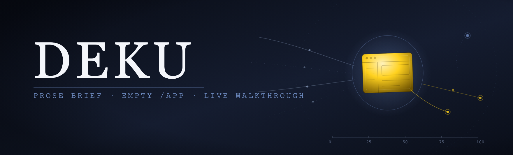
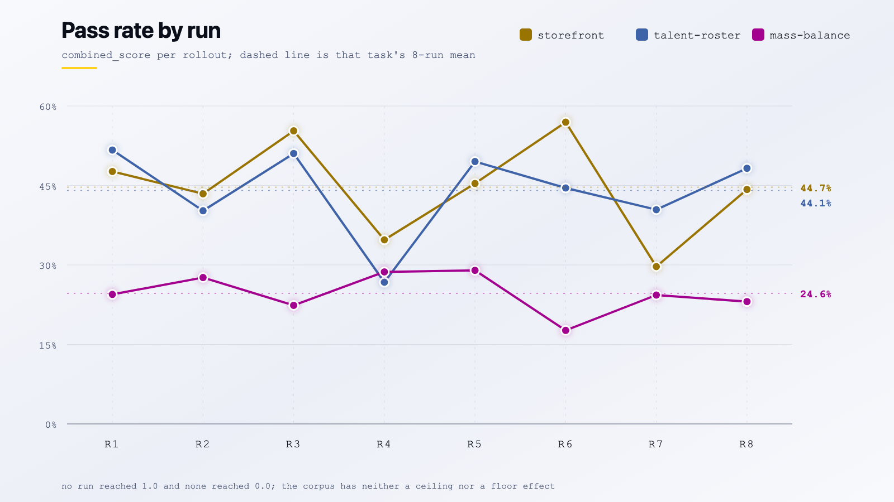
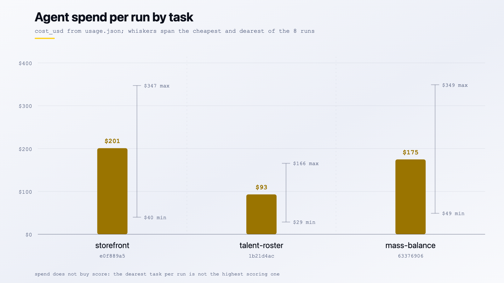
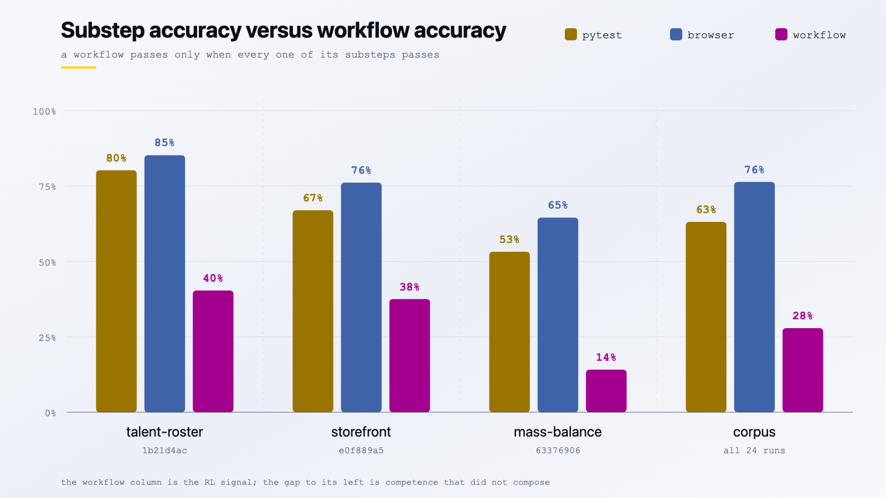
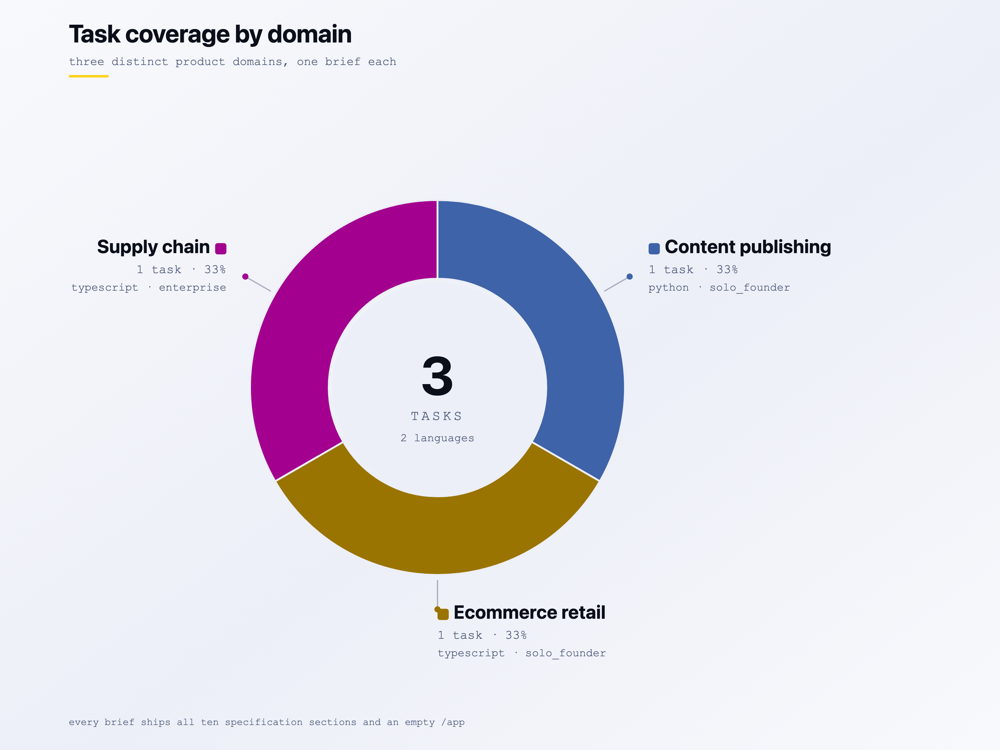
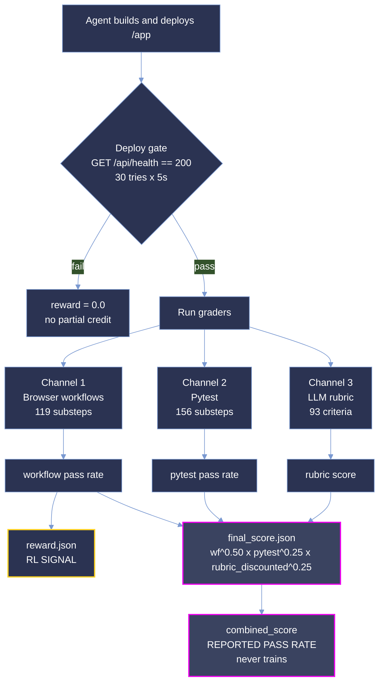

<p align="center">
  <picture>
    <source type="image/svg+xml" srcset="images/hero.svg">
    
  </picture>
</p>

<p align="center">
  <strong>Measuring whether a coding agent can build a working web application from a prose brief alone.</strong>
</p>

<p align="center">
  <a href="#summary"></a>
  <a href="#scoring-methodology"></a>
  <a href="#difficulty-tiers"></a>
  <a href="#reproduction"></a>
</p>

<p align="center"><sub>
  <a href="#summary">Summary</a> · <a href="#repository-layout">Layout</a> · <a href="#difficulty-tiers">Tiers</a> · <a href="#results">Results</a> · <a href="#analysis">Analysis</a> · <a href="#coverage">Coverage</a> · <a href="#dataset-structure">Dataset</a> · <a href="#trajectory-structure">Trajectories</a> · <a href="#scoring-methodology">Scoring</a> · <a href="#reproduction">Reproduction</a> · <a href="#verification">Verification</a> · <a href="#limitations">Limitations</a>
</sub></p>

# DEKU: 3-Task Greenfield Application Build Sample

**DEKU measures whether a coding agent can turn a prose product brief into a deployed, working web
application that a stranger can drive in a browser.**

Each task hands an agent a 47-94 KB specification, an empty `/app` and a service stack, and asks it
to ship something that boots, answers an HTTP health probe, and survives a live browser walkthrough
of its own user flows. There is no repository to patch, no failing test to flip and no oracle diff to
approximate. The hard part of every brief sits deliberately outside the app's own screens: `e0f889a5`
must prove an invoice really landed in Kill Bill ("a confirmation the app returns to itself does not
count"), `1b21d4ac` must make an unlisted record *absent* rather than merely unlinked, including its
generated media, and `63376906` must keep a mass-balance ledger that reconciles against physical
inputs.

This sample is narrow and deep: **3 tasks × 1 model × 8 runs = 24 graded rollouts.** The budget goes
on repetition rather than breadth, so difficulty is a measured rate over eight attempts rather than a
single observation. The three tasks span three domains, two languages and two sub-categories, and
land in two bands of opus-5's measured pass rate.

**Not one of the 24 rollouts passed every workflow.** Strict all-or-nothing scoring is therefore `0`
everywhere and carries no signal. Throughout this document **pass rate is the mean `combined_score`
over a task's 8 runs**, as a percentage:

```
pass_rate(task) = mean( combined_score over that task's 8 runs )
```

**This is *not* pass@k.** It is a partial-credit rate: a run scoring 40% contributes 40, not 0. It is
the same number the difficulty bands are cut on.

> **This is a curated, quality-controlled sample of the DEKU corpus,** provided for evaluation. The
> dataset format, trajectory format and scoring are identical to the production benchmark.

## Summary

| Property | Value |
| --- | --- |
| Tasks | 3 |
| Model | `opus-5` |
| Runs per task | 8 |
| Graded rollouts | 24 |
| Languages | Python (1), TypeScript (2) |
| Grader version | 0.22.0 |
| Harbor version | 0.20.0 |
| Reward signal | Workflow pass rate, `reward.json` |
| Specification volume | ~213 KB across 3 briefs |
| Sample size on disk | 2,669 files, 159 MB |

| Metric | Value (n=24) |
| --- | ---: |
| **Pass rate**, mean `combined_score` | **37.79%** |
| Pass rate range | 0.1765 to 0.5694 |
| Workflow reward, the RL signal | 30.67% |
| Workflows passed | 116 / 416 |
| Substeps passed | 1,515 / 2,200 |
| Rubric resolution | 82.5% |
| Total agent spend | $3,782.08 |

Two numbers travel together throughout this document and must not be confused. **Pass rate is `combined_score`** from `final_score.json`, a weighted geometric mean of the three grading channels:

```
combined_score = workflow^0.50 · pytest^0.25 · (rubric × rubric_coverage)^0.25
```

It is the headline measure of how much of a task an agent actually delivered. **`reward.json` carries the workflow pass rate alone**, and it is the only number that trains anything.

## Repository layout

```
deku-samples/
├── README.md                 # this document
├── LICENSE                   # MIT
├── images/                   # charts ship in -light and -dark variants
│   ├── hero.png
│   ├── pass_rate_by_run-{light,dark}.png
│   ├── cost_by_task-{light,dark}.png
│   ├── composition_gap-{light,dark}.png
│   └── tasks_by_domain-{light,dark}.png
└── <uuid>/                   # one self-contained directory per task (3)
    ├── task.toml, instruction.md, environment/, solution/, tests/
    └── trajectories/opus-5/run_1 … run_8
```

Task directories are named by UUID, and every task is referred to by its UUID prefix throughout this
document: `1b21d4ac` is `deku/talent-roster-reel` (python), `63376906` is
`deku/mass-balance-attestation` (typescript) and `e0f889a5` is `deku/hardware-companion-storefront`
(typescript). Each directory is a self-contained bundle: the brief, the environment that hosts it,
the reference solution, the grader, and all eight trajectories recorded against it.

Every chart below is derived from the shipped `final_score.json`, `reward.json`, `workflows.json`
and `usage.json` files, and every figure in it re-derives from those bytes; see
[Reproduction](#reproduction). Nothing in the figures is hand-entered. The banner is hand-drawn
artwork and carries no data.

## Difficulty tiers

A tier is a **band on a measured rate**, the mean `combined_score` over eight runs:

| band | mean `combined_score` |
|---|---|
| `trivial` | ≥ 87.5% |
| `easy` | [50%, 87.5%) |
| `medium` | [37.5%, 50%) |
| `hard` | [25%, 37.5%) |
| `expert` | < 25% |

| tier | tasks |
|---|--:|
| `medium` | 2 |
| `expert` | 1 |

| task | pass rate | tier |
|---|--:|---|
| `e0f889a5` hardware-companion-storefront | 44.67% | `medium` |
| `1b21d4ac` talent-roster-reel | 44.05% | `medium` |
| `63376906` mass-balance-attestation | 24.65% | `expert` |

`[metadata].difficulty` is the only difficulty label `task.toml` ships, and it is cut on `opus-5`'s
mean over eight runs, the same rate reported above. Each bundle records that rate beside its label
as `pass_rate`, `pass_rate_ci` and `calibration_trials`, so the banding can be checked against the
shipped scores rather than taken on trust.

No task lands in `trivial`, `easy` or `hard`.

## Results

### Partial-credit pass rate by task

| Task | Pass rate | σ | Range | Workflow | Pytest | Rubric | Coverage |
| --- | ---: | ---: | --- | ---: | ---: | ---: | ---: |
| `e0f889a5` hardware-companion-storefront | 44.67% | 0.0924 | 0.297-0.569 | 0.3750 | 0.6696 | 0.5924 | 0.740 |
| `1b21d4ac` talent-roster-reel | 44.05% | 0.0830 | 0.267-0.517 | 0.4038 | 0.8023 | 0.4678 | 0.661 |
| `63376906` mass-balance-attestation | 24.65% | 0.0379 | 0.176-0.290 | 0.1413 | 0.5324 | 0.3512 | 1.000 |

`63376906` is the wall. It is the only enterprise task, the only one requiring Keycloak, and it marks **85 of its 122 substeps critical**, a design in which almost nothing is allowed to be partially right. Eight runs never cleared a 29.0% pass rate, and a σ of 0.0379 says the agent failed in the same place every time. That is a structural block, not variance.

The top two tasks are a statistical tie: 0.62 points apart against σ of 0.083 and 0.092 on n=8. Read them as equivalent, not ranked.

### Per-run pass rate

Each cell is that run's `combined_score`.

<picture>
  <source type="image/svg+xml" media="(prefers-color-scheme: dark)" srcset="images/pass_rate_by_run-dark.svg">
  <source type="image/svg+xml" srcset="images/pass_rate_by_run-light.svg">
  <source media="(prefers-color-scheme: dark)" srcset="images/pass_rate_by_run-dark.png">
  <source media="(prefers-color-scheme: light)" srcset="images/pass_rate_by_run-light.png">
  
</picture>

| Task | run_1 | run_2 | run_3 | run_4 | run_5 | run_6 | run_7 | run_8 |
| --- | ---: | ---: | ---: | ---: | ---: | ---: | ---: | ---: |
| `e0f889a5` | 0.476 | 0.434 | 0.553 | 0.347 | 0.454 | 0.569 | 0.297 | 0.442 |
| `1b21d4ac` | 0.517 | 0.402 | 0.510 | 0.267 | 0.495 | 0.445 | 0.404 | 0.482 |
| `63376906` | 0.244 | 0.276 | 0.224 | 0.287 | 0.290 | 0.176 | 0.243 | 0.231 |

**No run scored 1.0 and no run scored 0.0**, on either the pass rate or the underlying reward. The corpus has neither a ceiling nor a floor effect.

All 24 runs scored under the full exponents `{workflow 0.50, pytest 0.25, rubric 0.25}`: the rubric channel never fully unresolved, so `weights_applied` never renormalised. The lowest channel value anywhere in the corpus is a workflow score of 0.087, so no run approached the zero that would collapse the product.

### Cost and effort

| Aggregate | Value |
| --- | ---: |
| Total agent spend | **$3,782.08** |
| Per-run range | $28.53 to $349.03 |
| Input tokens | 659,866,603 |
| Output tokens | 9,128,383 |
| Cache-read tokens | 641,330,253 |
| Requests | 31,843 |

| Task | Cost / run | Requests / run |
| --- | ---: | ---: |
| `1b21d4ac` | $97.19 | 1,125 |
| `63376906` | $174.61 | 1,640 |
| `e0f889a5` | $200.95 | 1,216 |

<picture>
  <source type="image/svg+xml" media="(prefers-color-scheme: dark)" srcset="images/cost_by_task-dark.svg">
  <source type="image/svg+xml" srcset="images/cost_by_task-light.svg">
  <source media="(prefers-color-scheme: dark)" srcset="images/cost_by_task-dark.png">
  <source media="(prefers-color-scheme: light)" srcset="images/cost_by_task-light.png">
  
</picture>

Output is **1.4% of input**. These agents are overwhelmingly reading (the brief, their own files, browser state), not writing. The 12× per-run cost spread inside a single model matters more than the mean: the same model on the same task can cost $29 or $349 depending on how early it finds its footing. Spend does not buy score either: `e0f889a5` costs 2.1× more per run than `1b21d4ac` and scores below it.

## Analysis

**Substep accuracy does not survive composition.** The corpus passes 76.4% of browser substeps and 63.1% of pytest substeps, yet only **27.9% of workflows**. A workflow passes only when *every* substep in it passes, so partial competence collapses at the join. This gap is the single most important thing to understand about the benchmark: agents are broadly capable and narrowly reliable.

<picture>
  <source type="image/svg+xml" media="(prefers-color-scheme: dark)" srcset="images/composition_gap-dark.svg">
  <source type="image/svg+xml" srcset="images/composition_gap-light.svg">
  <source media="(prefers-color-scheme: dark)" srcset="images/composition_gap-dark.png">
  <source media="(prefers-color-scheme: light)" srcset="images/composition_gap-light.png">
  
</picture>

The workflow column is the RL signal. Everything to its left is competence the agent demonstrated but could not compose into a passing flow.

**Critical failures concentrate almost entirely in one task.** Of 437 critical substep failures, **318 (73%) belong to `63376906`**, an average of 40 per run against the 85 it marks critical. The other two tasks contribute 45 and 74 across all eight runs each.

**Rubric coverage tracks how objectively a task can be observed.** `63376906` resolves **100%** of its rubric criteria. The two aesthetic-weighted solo-founder tasks resolve 66% and 74%, and account for **all 130 unresolved verdicts**. The causes are instrumentation limits, not model failures: 26 evaluator HTTP 400s, 9 screenshots degraded in transport, 7 cases where the browser cannot emulate `prefers-reduced-motion`, 3 where it cannot compare hover against no-hover, and 85 where the collected evidence simply did not settle the question. Criteria `1b21d4ac:R4`, `1b21d4ac:R12` and `e0f889a5:R5` went unresolved in **all eight runs**; those are grader gaps, not model gaps.

**Deploy is a cliff, not a slope.** `tests/test.sh` polls `${APP_PUBLIC_URL}/api/health` for HTTP 200 (30 attempts at 5-second intervals) before any grading runs. An app that misses that probe scores zero with no partial credit for code that would have worked. All 24 rollouts cleared it.

**The grader distrusts itself by design.** `reward.json` carries only the workflow pass rate. `final_score.json` computes `0.5·workflow + 0.25·pytest + 0.25·rubric` and labels it *"a report, not a training signal."* `verifier/judge.json` carries an LLM `judge_score` that never reaches training. Three scores exist; exactly one is allowed to train.

## Coverage

<picture>
  <source type="image/svg+xml" media="(prefers-color-scheme: dark)" srcset="images/tasks_by_domain-dark.svg">
  <source type="image/svg+xml" srcset="images/tasks_by_domain-light.svg">
  <source media="(prefers-color-scheme: dark)" srcset="images/tasks_by_domain-dark.png">
  <source media="(prefers-color-scheme: light)" srcset="images/tasks_by_domain-light.png">
  
</picture>

| Axis | Distribution |
| --- | --- |
| Language | typescript 2, python 1 |
| Sub-category | solo_founder 2, enterprise 1 |
| Service profile | P1-db, P5-db-pay-email, P6-db-auth-email |
| Services | postgres 3, mailpit 2, keycloak 1, killbill 1 |
| Design direction | editorial-serif 2, dense-ops-console 1 |
| Spec sections given | all 10, on all 3 tasks |

Every task ships the full ten-section brief: overview, roles, features, flow, uiux, frontend, techrequirements, datamodel, constraints, contract.

### Full task list

| UUID | Name | Lang | Domain / pattern | Services | Workflows | Substeps | Critical | Rubric | Reqs | Turns | Tokens |
| --- | --- | --- | --- | --- | ---: | ---: | ---: | ---: | ---: | ---: | ---: |
| `1b21d4ac` | deku/talent-roster-reel | python | content-publishing / directory-matching | postgres | 13 | 93 | 25 | 28 | 135 | 120 | 4.5M |
| `63376906` | deku/mass-balance-attestation | typescript | supply-chain-inventory / inventory-allocation | postgres, keycloak, mailpit | 23 | 122 | 85 | 39 | 137 | 200 | 8.0M |
| `e0f889a5` | deku/hardware-companion-storefront | typescript | ecommerce-retail / commerce-checkout | postgres, killbill, mailpit | 16 | 60 | 28 | 26 | 73 | 200 | 7.5M |

Totals: **52 workflows**, **275 substeps** (156 pytest, 119 browser), **138 critical**, **93 rubric criteria**, **345 traceability rows** of which 339 carry a `YES` verdict.

## Dataset structure

```
<task-uuid>/
├── task.toml                   schema 1.4 task definition
├── instruction.md              the brief (47-94 KB)
├── environment/
│   ├── Dockerfile
│   ├── docker-compose.yaml
│   ├── postgres-init.sql
│   ├── keycloak-realm.json          (63376906 only)
│   └── killbill-init.sh, killbill-shiro.ini   (e0f889a5 only)
├── solution/
│   ├── TRUTH.md                reference behaviour narrative
│   ├── app/                    USER_README.md, run.json
│   ├── checklist.md
│   └── solve.sh
├── tests/
│   ├── test.sh, conftest.py
│   ├── workflows.yaml          browser + pytest substeps, cov: requirement IDs
│   ├── rubric.json             LLM-judged criteria
│   ├── test_<name>.py
│   └── traceability-matrix.csv requirement → T*/W*/R* coverage matrix
└── trajectories/opus-5/run_1…run_8/
```

`instruction.md` is the contract. `workflows.yaml` is the grader. `traceability-matrix.csv` is the proof that every clause of the former is reachable by the latter: each row maps a requirement to the specific tests (`T1…`), workflows (`W1…`) and rubric criteria (`R1…`) that exercise it.

`solution/app/run.json` is a `run-manifest-v1` declaring how the reference build installs, builds and serves: for `1b21d4ac`, `pip install -r requirements.txt` then `gunicorn --bind 0.0.0.0:${APP_PUBLIC_PORT} app:app`.

## Trajectory structure

```
run_N/
├── reward.json          {"reward": <workflow pass rate>}   ← the RL signal
├── final_score.json     combined_score, per-channel breakdown,
│                        and every unresolved criterion with its rationale
├── workflows.json       summary + per-workflow, per-substep verdicts
├── usage.json           tokens + cost, split across agent / browser_grader / rubric_judge
├── app/                 the application the agent built
├── screenshots/         NN_route_WxH.png at 1920x1200, 768x1024, 390x844
├── trajectory/
│   └── trajectory.json
└── verifier/
    ├── browser_results.json     per-workflow browser evidence
    ├── pytest_ctrf.json         CTRF-format test report
    └── judge.json               advisory judge_score
```

The sample carries **485 screenshots** across the 24 rollouts, captured at three viewports per route so responsive criteria are judged from real renders rather than CSS inspection.

## Scoring methodology

Three channels are computed per run over three different objects (the running application, the
delivered source, and the recorded evidence), all behind a hard deploy gate. They compose into the
headline number as a weighted geometric mean, and exactly one of them is allowed to train anything.



### How the channels combine

`combined_score` is a **weighted geometric mean**, not a weighted average:

```
combined_score = workflow^0.50 · pytest^0.25 · (rubric × rubric_coverage)^0.25
```

Two properties follow, and both are deliberate.

**A weak channel cannot be bought back.** Under an arithmetic mean, a 0.80 pytest score offsets a 0.14 workflow score and the run still reports respectably. Under a geometric mean the product is dragged toward the weakest term, so the score answers *"was this competent across all three at once?"* rather than *"how much credit did it accumulate anywhere?"* The penalty relative to an arithmetic mean scales with how lopsided the run was: 11.2% for the most balanced task in this sample, 15.5% for the least.

**Rubric credit is proportional to what was observable.** Unresolved criteria are excluded from `rubric.score`, which would otherwise hand a run full credit for the fraction of the rubric the grader happened to settle. Multiplying by `rubric_coverage` removes that unearned credit. `63376906` resolves its whole rubric and is unaffected; `1b21d4ac` resolves 66% and absorbs the largest discount.

Each run records its own arithmetic in `final_score.json` under `scoring`, alongside `components.rubric.score_discounted`.

### Channel 1: Browser workflows

A workflow passes only when **all** of its substeps pass. `reward` is the fraction of workflows that pass, and it is the only number that trains anything. Substeps declare `kind: browser` or `kind: pytest`, an optional `critical: true`, and a `cov:` list of requirement IDs. 119 of the 275 substeps are driven through a real browser against the running app.

### Channel 2: Pytest

156 substeps execute as pytest cases inside the verifier container, producing 1,248 test results across the corpus (788 passed, 460 failed, **0 skipped, 0 pending, 0 errored**). `test.sh` deliberately omits `set -e`: a failing test is a *score*, not a harness error. The script writes `{"reward": 0.0}` before anything else runs, so every exit path leaves a reward file behind; a missing file raises `RewardFileNotFoundError` and the trial is lost rather than scored zero.

### Channel 3: LLM rubric

93 criteria, two of them **negative** criteria that penalise behaviour rather than reward it. The rubric now carries source-quality dimensions alongside behavioural ones:

| Dimension | Criteria | | Dimension | Criteria |
| --- | ---: | --- | --- | ---: |
| internal_consistency | 16 | | ux_flow | 7 |
| ui_visual | 14 | | responsiveness | 6 |
| scope_discipline | 13 | | motion | 5 |
| instruction_following | 11 | | accessibility | 5 |
| functionality | 11 | | abstraction, dead_code, naming, readability, idiomaticity | 1 each |

Importance splits 39 important / 36 critically_important / 18 somewhat_important. Evaluation targets are `state_change` (57), `user_facing_message` (33) and `trajectory` (3).

Verdicts resolve to PASS, FAIL, INSUFFICIENT_EVIDENCE or EVALUATOR_ERROR, reached by one of four methods: `source_audit` (342), `active_acquisition` (239), `browser_audit` (33), or left `machine_unresolved` (130). When a channel fully unresolves, `rubric.score` is `null`, the rubric key drops out of `weights_applied`, and the remaining exponents renormalise to sum to 1.0. That path was **not** exercised here, as all 24 runs scored under the full exponents.

## Reproduction

Every figure re-derives from the shipped bytes; no re-execution is needed. All snippets run from the
repository root, using the Python standard library or `jq` over the JSON the bundles already carry.

**Recompute the pass rate for a single task, alongside the reward it is built on:**

```python
import json, pathlib

runs = sorted(
    pathlib.Path("1b21d4ac-055a-52e7-b754-0620f337b0d4/trajectories/opus-5").glob("run_*"),
    key=lambda p: int(p.name.split("_")[1]),
)
scores  = [json.loads((r / "final_score.json").read_text())["combined_score"] for r in runs]
rewards = [json.loads((r / "reward.json").read_text())["reward"] for r in runs]

print(f"n={len(runs)}  pass_rate={sum(scores)/len(scores):.4f}  reward={sum(rewards)/len(rewards):.4f}")
# -> n=8  pass_rate=0.4405  reward=0.4038
```

**Total agent spend across the sample:**

```bash
find . -name usage.json -print0 \
  | xargs -0 jq -s 'map(.cost_usd) | add | .*100|round/100'
# -> 3782.08
```

**Rubric resolution across all 24 rollouts:**

```bash
find . -name final_score.json -print0 \
  | xargs -0 jq -s '[.[].components.rubric.machine_outcomes]
                    | {PASS:  map(.PASS)  | add,
                       FAIL:  map(.FAIL)  | add,
                       INSUF: map(.INSUFFICIENT_EVIDENCE) | add,
                       ERROR: map(.EVALUATOR_ERROR)       | add}'
# -> {"PASS": 288, "FAIL": 326, "INSUF": 130, "ERROR": 0}
```

**Confirm every rollout deployed and none was flagged:**

```bash
find . -name workflows.json -print0 \
  | xargs -0 jq -s '{runs:     length,
                     deployed: map(select(.summary.deployed == 1.0)) | length,
                     degraded: map(select(.summary.degraded != [])) | length,
                     invalid:  map(select(.summary.invalid  != [])) | length}'
# -> {"runs": 24, "deployed": 24, "degraded": 0, "invalid": 0}
```

**Workflow composition gap, substep accuracy versus workflow accuracy:**

```bash
find . -name workflows.json -print0 \
  | xargs -0 jq -s '[.[].summary]
                    | {workflows: "\(map(.workflows_passed)|add)/\(map(.workflows_total)|add)",
                       browser:   "\(map(.browser_substeps_passed)|add)/\(map(.browser_substeps_total)|add)",
                       pytest:    "\(map(.pytest_substeps_passed)|add)/\(map(.pytest_substeps_total)|add)",
                       critical_failed: map(.critical_substeps_failed) | add}'
# -> {"workflows": "116/416", "browser": "727/952", "pytest": "788/1248", "critical_failed": 437}
```

**Regenerate the `.png` fallbacks from the shipped SVGs.** Each `.png` in `images/` is a
browser-rendered export of the `.svg` beside it:

```bash
for f in images/*-light.svg images/*-dark.svg; do
  case "$f" in *tasks_by_domain*) SIZE=1600,1200 ;; *) SIZE=1600,900 ;; esac
  chrome --headless --disable-gpu --hide-scrollbars \
         --screenshot="${f%.svg}.png" --window-size=$SIZE "file://$PWD/$f"
done
```

## Verification

Every claim below was checked against the shipped bytes.

- All 24 rollouts deployed successfully and cleared the `/api/health` gate.
- `invalid = []` and `degraded = []` on every rollout.
- All 24 run directories are structurally complete, with no missing `reward.json`, `final_score.json`,
  `workflows.json`, `usage.json`, `verifier/`, `app/`, `screenshots/` or `trajectory/`.
- All 24 `trajectory.json` files are present and parse as valid JSON.
- `reward` in `reward.json` matches `workflows_passed / workflows_total` on all 24 runs.
- `combined_score` recomputes from its three channels on all 24 runs, to within `0.001`.
- Pytest reported 0 skipped, 0 pending and 0 errored across 1,248 test results; every result is a
  real pass or a real fail.
- 0 `EVALUATOR_ERROR` verdicts across 744 rubric criteria.
- 339 of 345 traceability rows carry a `YES` verdict.
- `uuid_v5` in each `task.toml` matches its directory name.
- No rollout scored 1.0 or 0.0, so there is no ceiling or floor saturation.

## Limitations

**Sample size.** Three tasks under one model is a small corpus. Every figure here describes these
three tasks under `opus-5`; none of it estimates the wider corpus, and each band rests on one or two
tasks, so a band row is close to a task row.

**No clean solves.** No rollout passed every workflow, so a strict pass/fail metric reports 0% and
separates nothing. The ranking is entirely a partial-credit result, and the corpus cannot distinguish
an agent that nearly finished a task from one that passed a large fraction of its independent checks.

**Single model, single scaffold.** Every rollout is `opus-5`. Nothing here supports a cross-model
claim, and the tier assignment has no second model reported against it.

**Calibration provenance is partial.** `difficulty`, `pass_rate`, `pass_rate_ci`,
`reference_model_used` and `calibration_trials` are cut from the eight `opus-5` runs shipped here,
but `calibration_date` and `openhands_version` are still empty strings, so the calibration cannot be
dated or tied to a specific harness build.

**Unresolved rubric verdicts.** 130 of 744 verdicts (17.5%) are unresolved, all of them on `1b21d4ac`
and `e0f889a5`. 26 trace to evaluator HTTP 400s from `http://host.docker.internal:8790/responses`;
the rest to browser-tool and screenshot limits. Rubric figures in this document are means over
resolved verdicts only, and `1b21d4ac` run_5 sets `needs_human_review = 12`, the only rollout in the
corpus awaiting human adjudication.

**Uneven browser evidence.** `e0f889a5` captured only 4-6 screenshots per run against 24-41 for the
other two tasks, which is consistent with its lower rubric coverage.

**Missing provenance.** `INDEX.json`, `provenance.yaml` and the `solution/trinity/`
grading-derivation set are not included, and `[delivery]` and `[signoff]` blocks are absent from all
three `task.toml` files, so run-to-run task checksums cannot be verified from the bundle alone.

**Cost figures.** Costs are the harness's own `cost_usd` accounting, not billed invoices.

## License

MIT © 2026 Ethara.AI. See [LICENSE](LICENSE).

Task content, specification briefs and recorded trajectories are released under the same terms.
