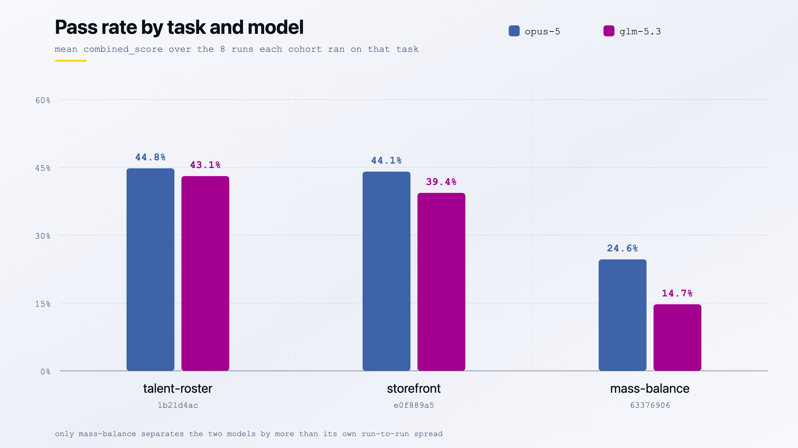
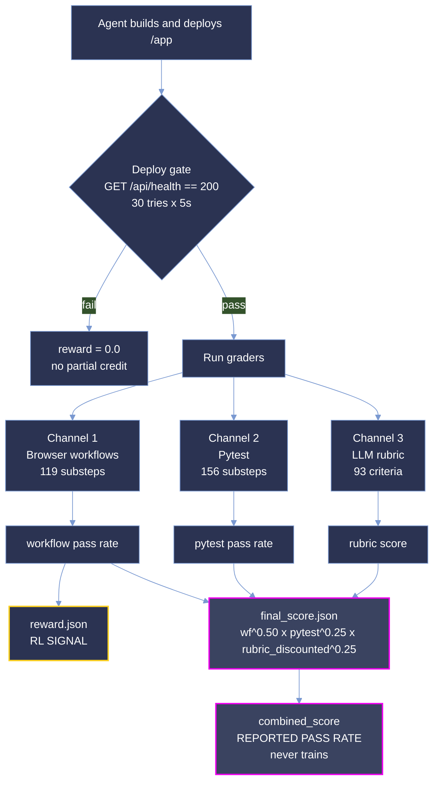

<p align="center">
  <picture>
    <source type="image/svg+xml" srcset="images/hero.svg">
    
  </picture>
</p>

<p align="center">
  <strong>Measuring whether a coding agent can build a working web application from a prose brief alone.</strong>
</p>

<p align="center">
  <a href="#summary"></a>
  <a href="#scoring-methodology"></a>
  <a href="#difficulty-tiers"></a>
  <a href="#reproduction"></a>
</p>

<p align="center"><sub>
  <a href="#summary">Summary</a> · <a href="#repository-layout">Layout</a> · <a href="#difficulty-tiers">Tiers</a> · <a href="#results">Results</a> · <a href="#analysis">Analysis</a> · <a href="#coverage">Coverage</a> · <a href="#dataset-structure">Dataset</a> · <a href="#trajectory-structure">Trajectories</a> · <a href="#scoring-methodology">Scoring</a> · <a href="#reproduction">Reproduction</a> · <a href="#verification">Verification</a> · <a href="#limitations">Limitations</a>
</sub></p>

# DEKU: 3-Task Greenfield Application Build Sample

**DEKU measures whether a coding agent can turn a prose product brief into a deployed, working web
application that a stranger can drive in a browser.**

Each task hands an agent a 47-94 KB specification, an empty `/app` and a service stack, and asks it
to ship something that boots, answers an HTTP health probe, and survives a live browser walkthrough
of its own user flows. There is no repository to patch, no failing test to flip and no oracle diff to
approximate. The hard part of every brief sits deliberately outside the app's own screens: `e0f889a5`
must prove an invoice really landed in Kill Bill ("a confirmation the app returns to itself does not
count"), `1b21d4ac` must make an unlisted record *absent* rather than merely unlinked, including its
generated media, and `63376906` must keep a mass-balance ledger that reconciles against physical
inputs.

This sample is narrow and deep: **3 tasks × 2 models × 8 runs = 48 graded rollouts.** The budget goes
on repetition rather than breadth, so difficulty is a measured rate over eight attempts rather than a
single observation. The three tasks span three domains, two languages and two sub-categories, and
land in two bands of opus-5's measured pass rate. Both cohorts, `opus-5` and `glm-5.3`, run the same
briefs through the same graders, so the two are directly comparable.

**Not one of the 48 rollouts passed every workflow.** Strict all-or-nothing scoring is therefore `0`
everywhere and carries no signal. Throughout this document **pass rate is the mean `combined_score`
over a task's 8 runs for a given model**, as a percentage:

```
pass_rate(task, model) = mean( combined_score over that model's 8 runs on that task )
```

**This is *not* pass@k.** It is a partial-credit rate: a run scoring 40% contributes 40, not 0. It is
the same number the difficulty bands are cut on.

> **This is a curated, quality-controlled sample of the DEKU corpus,** provided for evaluation. The
> dataset format, trajectory format and scoring are identical to the production benchmark.

## Summary

| Property | Value |
| --- | --- |
| Tasks | 3 |
| Models | `opus-5`, `glm-5.3` |
| Runs per task per model | 8 |
| Graded rollouts | 48 |
| Languages | Python (1), TypeScript (2) |
| Grader version | 0.22.0 |
| Harbor version | 0.20.0 |
| Reward signal | Workflow pass rate, `reward.json` |
| Specification volume | ~213 KB across 3 briefs |
| Sample size on disk | 5,264 files, 371 MB |

| Metric | `opus-5` (n=24) | `glm-5.3` (n=24) |
| --- | ---: | ---: |
| **Pass rate**, mean `combined_score` | **37.84%** | **32.38%** |
| Pass rate range | 0.1765 to 0.5436 | 0.0847 to 0.5752 |
| Workflow reward, the RL signal | 30.67% | 22.65% |
| Workflows passed | 116 / 416 | 83 / 416 |
| Substeps passed | 1,515 / 2,200 | 1,303 / 2,200 |
| Rubric resolution | 100% | 100% |
| Total agent spend | $3,782.08 | $760.35 |

Across all 48 rollouts the corpus pass rate is **35.11%**, with σ 0.1370 and a range of 0.0847 to
0.5752. `opus-5` leads `glm-5.3` by 5.45 points overall, but that margin is carried almost entirely
by one task; see [Results](#results).

Two numbers travel together throughout this document and must not be confused. **Pass rate is `combined_score`** from `final_score.json`, a weighted geometric mean of the three grading channels:

```
combined_score = workflow^0.50 · pytest^0.25 · (rubric × rubric_coverage)^0.25
```

It is the headline measure of how much of a task an agent actually delivered. **`reward.json` carries the workflow pass rate alone**, and it is the only number that trains anything.

## Repository layout

```
deku-samples/
├── README.md                 # this document
├── LICENSE                   # MIT
├── images/                   # charts ship in -light and -dark variants
│   ├── hero.png
│   ├── pass_rate_by_model-{light,dark}.png
│   ├── pass_rate_by_run-{light,dark}.png
│   ├── cost_by_task-{light,dark}.png
│   ├── composition_gap-{light,dark}.png
│   └── tasks_by_domain-{light,dark}.png
└── <uuid>/                   # one self-contained directory per task (3)
    ├── task.toml, instruction.md, environment/, solution/, tests/
    └── trajectories/
        ├── opus-5/run_1 … run_8
        └── glm-5.3/run_1 … run_8
```

Task directories are named by UUID, and every task is referred to by its UUID prefix throughout this
document: `1b21d4ac` is `deku/talent-roster-reel` (python), `63376906` is
`deku/mass-balance-attestation` (typescript) and `e0f889a5` is `deku/hardware-companion-storefront`
(typescript). Each directory is a self-contained bundle: the brief, the environment that hosts it,
the reference solution, the grader, and all sixteen trajectories recorded against it.

Every chart below is derived from the shipped `final_score.json`, `reward.json`, `workflows.json`
and `usage.json` files, and every figure in it re-derives from those bytes; see
[Reproduction](#reproduction). Nothing in the figures is hand-entered. The banner is hand-drawn
artwork and carries no data.

Every results figure shows both cohorts. `tasks_by_domain` is the one exception: it describes corpus
composition rather than results, and has no model dimension.

## Difficulty tiers

A tier is a **band on a measured rate**, the mean `combined_score` over eight runs:

| band | mean `combined_score` |
|---|---|
| `trivial` | ≥ 87.5% |
| `easy` | [50%, 87.5%) |
| `medium` | [37.5%, 50%) |
| `hard` | [25%, 37.5%) |
| `expert` | < 25% |

| tier | tasks |
|---|--:|
| `medium` | 2 |
| `expert` | 1 |

| task | `opus-5` pass rate | tier | `glm-5.3` pass rate | tier if cut on `glm-5.3` |
|---|--:|---|--:|---|
| `1b21d4ac` talent-roster-reel | 44.80% | `medium` | 43.07% | `medium` |
| `e0f889a5` hardware-companion-storefront | 44.06% | `medium` | 39.36% | `medium` |
| `63376906` mass-balance-attestation | 24.65% | `expert` | 14.72% | `expert` |

`[metadata].difficulty` is the only difficulty label `task.toml` ships, and it is cut on `opus-5`'s
mean over eight runs, the same rate reported in the second column. `reference_model_used` records
that choice explicitly. Each bundle stores the rate beside its label as `pass_rate`, `pass_rate_ci`
and `calibration_trials`, so the banding can be checked against the shipped scores rather than taken
on trust.

**The shipped tiers are not re-cut on `glm-5.3`.** The fourth column shows where each task would land
if they were, and the banding happens to agree on all three, though `63376906` sits far deeper inside
`expert` for `glm-5.3` (14.72% against 24.65%). Treat `difficulty` as an `opus-5` label throughout.

No task lands in `trivial`, `easy` or `hard` under either model.

## Results

### Partial-credit pass rate by task and model

| Task | Model | Pass rate | σ | Range | Workflow | Pytest | Rubric | Coverage |
| --- | --- | ---: | ---: | --- | ---: | ---: | ---: | ---: |
| `1b21d4ac` talent-roster-reel | `opus-5` | 44.80% | 0.0854 | 0.269-0.534 | 0.4038 | 0.8023 | 0.3227 | 1.000 |
| `1b21d4ac` talent-roster-reel | `glm-5.3` | 43.07% | 0.0854 | 0.313-0.575 | 0.3173 | 0.7384 | 0.4923 | 1.000 |
| `e0f889a5` hardware-companion-storefront | `opus-5` | 44.06% | 0.0873 | 0.304-0.544 | 0.3750 | 0.6696 | 0.4184 | 1.000 |
| `e0f889a5` hardware-companion-storefront | `glm-5.3` | 39.36% | 0.1038 | 0.191-0.501 | 0.2969 | 0.6071 | 0.5139 | 1.000 |
| `63376906` mass-balance-attestation | `opus-5` | 24.65% | 0.0379 | 0.176-0.290 | 0.1413 | 0.5324 | 0.3512 | 1.000 |
| `63376906` mass-balance-attestation | `glm-5.3` | 14.72% | 0.0487 | 0.085-0.220 | 0.0652 | 0.3574 | 0.3461 | 1.000 |

<picture>
  <source type="image/svg+xml" media="(prefers-color-scheme: dark)" srcset="images/pass_rate_by_model-dark.svg">
  <source type="image/svg+xml" srcset="images/pass_rate_by_model-light.svg">
  <source media="(prefers-color-scheme: dark)" srcset="images/pass_rate_by_model-dark.png">
  <source media="(prefers-color-scheme: light)" srcset="images/pass_rate_by_model-light.png">
  
</picture>

`63376906` is the wall, under both models. It is the only enterprise task, the only one requiring Keycloak, and it marks **85 of its 122 substeps critical**, a design in which almost nothing is allowed to be partially right. `opus-5` never cleared 29.0% across eight runs, `glm-5.3` never cleared 22.0%, and σ of 0.0379 and 0.0487 say each model failed in the same place every time. That is a structural block, not variance.

For `opus-5` the top two tasks are a statistical tie: 0.74 points apart against σ of 0.085 and 0.087 on n=8. Read them as equivalent, not ranked. `glm-5.3` separates them slightly more, by 3.71 points, but still within its own spread.

### Model comparison

| Task | `opus-5` | `glm-5.3` | Δ |
| --- | ---: | ---: | ---: |
| `1b21d4ac` talent-roster-reel | 44.80% | 43.07% | -1.73 |
| `e0f889a5` hardware-companion-storefront | 44.06% | 39.36% | -4.71 |
| `63376906` mass-balance-attestation | 24.65% | 14.72% | -9.92 |
| **Corpus** | **37.84%** | **32.38%** | **-5.45** |

**Only `63376906` separates the two models beyond their own noise.** The 1.73-point gap on
`1b21d4ac` sits well inside a σ of 0.085 on n=8 and should be read as a tie. `e0f889a5` at 4.71
points against σ of 0.087 and 0.104 is suggestive but not decisive. The 9.92-point gap on
`63376906` is several times its σ of 0.038 and 0.049, and it alone carries most of the corpus
margin. A two-model, three-task sample cannot support a general ranking claim; what it shows is that
the two models diverge specifically where the task is hardest.

### Per-run pass rate

Each cell is that run's `combined_score`. In the figure, solid lines with filled markers are
`opus-5` and dashed lines with hollow markers are `glm-5.3`; colour identifies the task.

<picture>
  <source type="image/svg+xml" media="(prefers-color-scheme: dark)" srcset="images/pass_rate_by_run-dark.svg">
  <source type="image/svg+xml" srcset="images/pass_rate_by_run-light.svg">
  <source media="(prefers-color-scheme: dark)" srcset="images/pass_rate_by_run-dark.png">
  <source media="(prefers-color-scheme: light)" srcset="images/pass_rate_by_run-light.png">
  
</picture>

`opus-5`:

| Task | run_1 | run_2 | run_3 | run_4 | run_5 | run_6 | run_7 | run_8 |
| --- | ---: | ---: | ---: | ---: | ---: | ---: | ---: | ---: |
| `1b21d4ac` | 0.502 | 0.491 | 0.491 | 0.269 | 0.534 | 0.432 | 0.385 | 0.480 |
| `e0f889a5` | 0.496 | 0.410 | 0.537 | 0.341 | 0.464 | 0.544 | 0.304 | 0.428 |
| `63376906` | 0.244 | 0.276 | 0.224 | 0.287 | 0.290 | 0.176 | 0.243 | 0.231 |

`glm-5.3`:

| Task | run_1 | run_2 | run_3 | run_4 | run_5 | run_6 | run_7 | run_8 |
| --- | ---: | ---: | ---: | ---: | ---: | ---: | ---: | ---: |
| `1b21d4ac` | 0.426 | 0.443 | 0.474 | 0.575 | 0.432 | 0.465 | 0.313 | 0.317 |
| `e0f889a5` | 0.331 | 0.400 | 0.415 | 0.490 | 0.475 | 0.191 | 0.345 | 0.501 |
| `63376906` | 0.085 | 0.118 | 0.187 | 0.121 | 0.122 | 0.220 | 0.123 | 0.203 |

**No run scored 1.0 and no run scored 0.0**, on either the pass rate or the underlying reward, under either model. The corpus has neither a ceiling nor a floor effect.

All 48 runs scored under the full exponents `{workflow 0.50, pytest 0.25, rubric 0.25}`: the rubric channel resolved on every run, so `weights_applied` never renormalised. The lowest channel value anywhere in the corpus is a workflow score of 0.0435, on `glm-5.3` `63376906` run_1, so no run approached the zero that would collapse the product.

### Cost and effort

| Aggregate | `opus-5` | `glm-5.3` |
| --- | ---: | ---: |
| Total agent spend | **$3,782.08** | **$760.35** |
| Per-run range | $28.53 to $349.03 | $13.10 to $52.42 |
| Input tokens | 659,866,603 | 59,523,108 |
| Output tokens | 9,128,383 | 10,698,432 |
| Cache-read tokens | 641,330,253 | 1,712,509,312 |
| Requests | 31,843 | 30,111 |

| Task | `opus-5` cost / run | `glm-5.3` cost / run | `opus-5` reqs / run | `glm-5.3` reqs / run |
| --- | ---: | ---: | ---: | ---: |
| `1b21d4ac` | $97.19 | $22.45 | 1,125 | 1,026 |
| `63376906` | $174.61 | $43.05 | 1,640 | 1,785 |
| `e0f889a5` | $200.95 | $29.55 | 1,216 | 953 |

<picture>
  <source type="image/svg+xml" media="(prefers-color-scheme: dark)" srcset="images/cost_by_task-dark.svg">
  <source type="image/svg+xml" srcset="images/cost_by_task-light.svg">
  <source media="(prefers-color-scheme: dark)" srcset="images/cost_by_task-dark.png">
  <source media="(prefers-color-scheme: light)" srcset="images/cost_by_task-light.png">
  
</picture>

**`glm-5.3` delivered 86% of `opus-5`'s pass rate for 20% of the spend.** That ratio is the most
practically useful number in this sample, and it is also the least transferable: it is a list-price
artifact of two particular rate cards, not a property of the benchmark. See the cost caveat under
[Limitations](#limitations), because the two spend figures are not derived the same way.

The two cohorts read and write very differently. For `opus-5`, output is **1.4% of input**: it is
overwhelmingly reading the brief, its own files and browser state. For `glm-5.3`, output is **18.0%
of input**, against 29× the cache-read volume, a markedly more cache-resident profile at comparable
request counts (30,111 against 31,843).

The per-run cost spread inside a single model matters more than the mean: `opus-5` ranges 12.2× from
$28.53 to $349.03 on the same tasks, `glm-5.3` only 4.0×. Spend does not buy score either, under
either model: `e0f889a5` costs `opus-5` 2.1× more per run than `1b21d4ac` and scores below it.

## Analysis

**Substep accuracy does not survive composition.** `opus-5` passes 76.4% of browser substeps and 63.1% of pytest substeps, yet only **27.9% of workflows**. `glm-5.3` shows the same shape: 70.4% browser, 50.7% pytest, **19.9% workflows**. A workflow passes only when *every* substep in it passes, so partial competence collapses at the join. This gap is the single most important thing to understand about the benchmark: agents are broadly capable and narrowly reliable, and that holds for both models.

| Channel | `opus-5` | `glm-5.3` |
| --- | ---: | ---: |
| Workflows | 116 / 416 (27.88%) | 83 / 416 (19.95%) |
| Browser substeps | 727 / 952 (76.37%) | 670 / 952 (70.38%) |
| Pytest substeps | 788 / 1,248 (63.14%) | 633 / 1,248 (50.72%) |
| Critical substep failures | 437 | 582 |

<picture>
  <source type="image/svg+xml" media="(prefers-color-scheme: dark)" srcset="images/composition_gap-dark.svg">
  <source type="image/svg+xml" srcset="images/composition_gap-light.svg">
  <source media="(prefers-color-scheme: dark)" srcset="images/composition_gap-dark.png">
  <source media="(prefers-color-scheme: light)" srcset="images/composition_gap-light.png">
  
</picture>

The workflow column is the RL signal. Everything to its left is competence the agent demonstrated but could not compose into a passing flow.

**Critical failures concentrate almost entirely in one task.** For `opus-5`, 318 of 437 critical substep failures (73%) belong to `63376906`, an average of 40 per run against the 85 it marks critical; the other two tasks contribute 45 and 74 across all eight runs each. `glm-5.3` concentrates harder still: 437 of 582 (75%), with 57 and 88 elsewhere.

**The rubric channel resolves completely, for both models.** Every task settles **100%** of its criteria under each cohort, with zero `INSUFFICIENT_EVIDENCE`, zero `EVALUATOR_ERROR` and no rollout left awaiting human adjudication:

| | `opus-5` | `glm-5.3` |
| --- | ---: | ---: |
| PASS / FAIL | 352 / 392 | 357 / 387 |
| `source_audit` | 351 | 304 |
| `active_acquisition` | 226 | 268 |
| `browser_audit` | 90 | 0 |
| `human_eval` | 77 (10.3%) | 172 (23.1%) |

Because coverage is 1.0 on every run, the `rubric_coverage` discount is inert throughout this sample: no run loses rubric credit to a grader blind spot, and the rubric column is directly comparable across all three tasks.

**The two cohorts were not adjudicated the same way.** `glm-5.3` has no `browser_audit` resolutions at all and leans on `human_eval` for 23.1% of its verdicts against `opus-5`'s 10.3%. This matters for the next paragraph: the rubric column is the one place where the two models are least comparable.

**`glm-5.3` scores higher on the rubric channel while scoring lower overall.** Its rubric means are 0.4923 and 0.5139 on the two solo-founder tasks against `opus-5`'s 0.3227 and 0.4184, yet it trails on `combined_score` everywhere. The deficit is concentrated entirely in workflow and pytest. Read alongside the adjudication asymmetry above, this is a finding to investigate rather than a clean claim that one model writes better code.

**Rubric scores are lower than workflow-adjacent intuition suggests.** With nothing excluded for being unobservable, `opus-5`'s rubric channel lands at 0.3227, 0.4184 and 0.3512, well under each task's pytest rate. A fully resolved rubric is a harsher rubric: criteria that a partially-blind grader would previously have dropped are now settled, and most of them settle as `FAIL`.

**Deploy is a cliff, not a slope.** `tests/test.sh` polls `${APP_PUBLIC_URL}/api/health` for HTTP 200 (30 attempts at 5-second intervals) before any grading runs. An app that misses that probe scores zero with no partial credit for code that would have worked. All 48 rollouts cleared it.

**The grader distrusts itself by design.** `reward.json` carries only the workflow pass rate. `final_score.json` computes `workflow^0.50 · pytest^0.25 · rubric_discounted^0.25` and labels it *"a report, not a training signal."* `verifier/judge.json` carries an LLM `judge_score` that never reaches training. Three scores exist; exactly one is allowed to train.

## Coverage

<picture>
  <source type="image/svg+xml" media="(prefers-color-scheme: dark)" srcset="images/tasks_by_domain-dark.svg">
  <source type="image/svg+xml" srcset="images/tasks_by_domain-light.svg">
  <source media="(prefers-color-scheme: dark)" srcset="images/tasks_by_domain-dark.png">
  <source media="(prefers-color-scheme: light)" srcset="images/tasks_by_domain-light.png">
  
</picture>

| Axis | Distribution |
| --- | --- |
| Language | typescript 2, python 1 |
| Sub-category | solo_founder 2, enterprise 1 |
| Service profile | P1-db, P5-db-pay-email, P6-db-auth-email |
| Services | postgres 3, mailpit 2, keycloak 1, killbill 1 |
| Design direction | editorial-serif 2, dense-ops-console 1 |
| Spec sections given | all 10, on all 3 tasks |

Every task ships the full ten-section brief: overview, roles, features, flow, uiux, frontend, techrequirements, datamodel, constraints, contract.

### Full task list

| UUID | Name | Lang | Domain / pattern | Services | Workflows | Substeps | Critical | Rubric | Reqs | Turns | Tokens |
| --- | --- | --- | --- | --- | ---: | ---: | ---: | ---: | ---: | ---: | ---: |
| `1b21d4ac` | deku/talent-roster-reel | python | content-publishing / directory-matching | postgres | 13 | 93 | 25 | 28 | 135 | 120 | 4.5M |
| `63376906` | deku/mass-balance-attestation | typescript | supply-chain-inventory / inventory-allocation | postgres, keycloak, mailpit | 23 | 122 | 85 | 39 | 137 | 200 | 8.0M |
| `e0f889a5` | deku/hardware-companion-storefront | typescript | ecommerce-retail / commerce-checkout | postgres, killbill, mailpit | 16 | 60 | 28 | 26 | 73 | 200 | 7.5M |

Totals: **52 workflows**, **275 substeps** (156 pytest, 119 browser), **138 critical**, **93 rubric criteria**, **345 traceability rows** of which 339 carry a `YES` verdict.

## Dataset structure

```
<task-uuid>/
├── task.toml                   schema 1.4 task definition
├── instruction.md              the brief (47-94 KB)
├── environment/
│   ├── Dockerfile
│   ├── docker-compose.yaml
│   ├── postgres-init.sql
│   ├── keycloak-realm.json          (63376906 only)
│   └── killbill-init.sh, killbill-shiro.ini   (e0f889a5 only)
├── solution/
│   ├── TRUTH.md                reference behaviour narrative
│   ├── app/                    USER_README.md, run.json
│   ├── checklist.md
│   └── solve.sh
├── tests/
│   ├── test.sh, conftest.py
│   ├── workflows.yaml          browser + pytest substeps, cov: requirement IDs
│   ├── rubric.json             LLM-judged criteria
│   ├── test_<name>.py
│   └── traceability-matrix.csv requirement → T*/W*/R* coverage matrix
└── trajectories/
    ├── opus-5/run_1…run_8/
    └── glm-5.3/run_1…run_8/
```

`instruction.md` is the contract. `workflows.yaml` is the grader. `traceability-matrix.csv` is the proof that every clause of the former is reachable by the latter: each row maps a requirement to the specific tests (`T1…`), workflows (`W1…`) and rubric criteria (`R1…`) that exercise it.

`solution/app/run.json` is a `run-manifest-v1` declaring how the reference build installs, builds and serves: for `1b21d4ac`, `pip install -r requirements.txt` then `gunicorn --bind 0.0.0.0:${APP_PUBLIC_PORT} app:app`.

## Trajectory structure

```
run_N/
├── reward.json          {"reward": <workflow pass rate>}   ← the RL signal
├── final_score.json     combined_score and per-channel breakdown
├── workflows.json       summary + per-workflow, per-substep verdicts
├── usage.json           tokens + cost, split across agent / browser_grader / rubric_judge
├── app/                 the application the agent built
├── screenshots/         NN_route_WxH.png at 1920x1200, 768x1024, 390x844
├── trajectory/
│   └── trajectory.json
└── verifier/
    ├── browser_results.json     per-workflow browser evidence
    ├── pytest_ctrf.json         CTRF-format test report
    └── judge.json               per-criterion rubric verdicts + advisory judge_score
```

The sample carries **983 screenshots** across the 48 rollouts, 506 for `opus-5` and 477 for `glm-5.3`, captured at three viewports per route so responsive criteria are judged from real renders rather than CSS inspection. These are the verifier's own captures; the agent-side captures under each run's `app/.browser_screenshots/` are build artifacts and are not counted here.

`final_score.json` carries a `machine_unresolved` array for criteria the grader could not settle. It is empty on all 48 rollouts in this sample.

## Scoring methodology

Three channels are computed per run over three different objects (the running application, the
delivered source, and the recorded evidence), all behind a hard deploy gate. They compose into the
headline number as a weighted geometric mean, and exactly one of them is allowed to train anything.



### How the channels combine

`combined_score` is a **weighted geometric mean**, not a weighted average:

```
combined_score = workflow^0.50 · pytest^0.25 · (rubric × rubric_coverage)^0.25
```

Two properties follow, and both are deliberate.

**A weak channel cannot be bought back.** Under an arithmetic mean, a 0.80 pytest score offsets a 0.14 workflow score and the run still reports respectably. Under a geometric mean the product is dragged toward the weakest term, so the score answers *"was this competent across all three at once?"* rather than *"how much credit did it accumulate anywhere?"* The penalty relative to an arithmetic mean scales with how lopsided the run was: 4.1% for the most balanced task and model in this sample (`opus-5` on `e0f889a5`), 29.4% for the least (`glm-5.3` on `63376906`).

**Rubric credit is proportional to what was observable.** Unresolved criteria are excluded from `rubric.score`, which would otherwise hand a run full credit for the fraction of the rubric the grader happened to settle. Multiplying by `rubric_coverage` removes that unearned credit. In this sample every task resolves its whole rubric under both models, so the multiplier is 1.0 on all 48 rollouts and no run absorbs a discount; the mechanism is retained because it is load-bearing on any run where a criterion cannot be settled.

Each run records its own arithmetic in `final_score.json` under `scoring`, alongside `components.rubric.score_discounted`.

### Channel 1: Browser workflows

A workflow passes only when **all** of its substeps pass. `reward` is the fraction of workflows that pass, and it is the only number that trains anything. Substeps declare `kind: browser` or `kind: pytest`, an optional `critical: true`, and a `cov:` list of requirement IDs. 119 of the 275 substeps are driven through a real browser against the running app.

### Channel 2: Pytest

156 substeps execute as pytest cases inside the verifier container, producing 1,248 test results per model (`opus-5`: 788 passed, 460 failed; `glm-5.3`: 633 passed, 615 failed; **0 skipped, 0 pending, 0 errored** in both). `test.sh` deliberately omits `set -e`: a failing test is a *score*, not a harness error. The script writes `{"reward": 0.0}` before anything else runs, so every exit path leaves a reward file behind; a missing file raises `RewardFileNotFoundError` and the trial is lost rather than scored zero.

### Channel 3: LLM rubric

93 criteria, two of them **negative** criteria that penalise behaviour rather than reward it. The rubric carries source-quality dimensions alongside behavioural ones:

| Dimension | Criteria | | Dimension | Criteria |
| --- | ---: | --- | --- | ---: |
| internal_consistency | 16 | | ux_flow | 7 |
| ui_visual | 14 | | responsiveness | 6 |
| scope_discipline | 13 | | motion | 5 |
| instruction_following | 11 | | accessibility | 5 |
| functionality | 11 | | abstraction, dead_code, naming, readability, idiomaticity | 1 each |

Importance splits 39 important / 30 critically_important / 24 somewhat_important, weighting each criterion 3 / 5 / 1 respectively. Evaluation targets are `state_change` (57), `user_facing_message` (33) and `trajectory` (3).

Verdicts resolve to PASS, FAIL, INSUFFICIENT_EVIDENCE or EVALUATOR_ERROR, reached by one of four methods. `opus-5` uses `source_audit` (351), `active_acquisition` (226), `browser_audit` (90) and `human_eval` (77); `glm-5.3` uses `source_audit` (304), `active_acquisition` (268) and `human_eval` (172), with no `browser_audit` at all. Across all 744 verdicts per model every criterion resolved to a PASS or a FAIL; nothing was left `machine_unresolved`. When a channel does fully unresolve, `rubric.score` is `null`, the rubric key drops out of `weights_applied`, and the remaining exponents renormalise to sum to 1.0. That path was **not** exercised here, as all 48 runs scored under the full exponents.

## Reproduction

Every figure re-derives from the shipped bytes; no re-execution is needed. All snippets run from the
repository root, using the Python standard library or `jq` over the JSON the bundles already carry.

**Recompute the pass rate for a single task and model, alongside the reward it is built on:**

```python
import json, pathlib

MODEL = "opus-5"   # or "glm-5.3"
runs = sorted(
    pathlib.Path(f"1b21d4ac-055a-52e7-b754-0620f337b0d4/trajectories/{MODEL}").glob("run_*"),
    key=lambda p: int(p.name.split("_")[1]),
)
scores  = [json.loads((r / "final_score.json").read_text())["combined_score"] for r in runs]
rewards = [json.loads((r / "reward.json").read_text())["reward"] for r in runs]

print(f"n={len(runs)}  pass_rate={sum(scores)/len(scores):.4f}  reward={sum(rewards)/len(rewards):.4f}")
# opus-5  -> n=8  pass_rate=0.4480  reward=0.4038
# glm-5.3 -> n=8  pass_rate=0.4307  reward=0.3173
```

**Total agent spend, per model:**

```bash
for m in opus-5 glm-5.3; do
  printf '%-8s ' "$m"
  find . -path "*/$m/*" -name usage.json -print0 \
    | xargs -0 jq -s 'map(.cost_usd) | add | .*100|round/100'
done
# -> opus-5   3782.08
# -> glm-5.3  760.35
```

**Rubric resolution across all 48 rollouts:**

```bash
for m in opus-5 glm-5.3; do
  printf '%-8s ' "$m"
  find . -path "*/$m/*" -name final_score.json -print0 \
    | xargs -0 jq -sc '[.[].components.rubric.machine_outcomes]
                       | {PASS:  map(.PASS)  | add,
                          FAIL:  map(.FAIL)  | add,
                          INSUF: map(.INSUFFICIENT_EVIDENCE) | add,
                          ERROR: map(.EVALUATOR_ERROR)       | add}'
done
# -> opus-5   {"PASS":352,"FAIL":392,"INSUF":0,"ERROR":0}
# -> glm-5.3  {"PASS":357,"FAIL":387,"INSUF":0,"ERROR":0}
```

**Confirm every criterion resolved and no rollout awaits a human:**

```bash
find . -name final_score.json -print0 \
  | xargs -0 jq -s '{runs:              length,
                     unresolved:        map(.components.rubric.unresolved) | add,
                     min_coverage:      map(.components.rubric.coverage)   | min,
                     needs_human_review: map(.needs_human_review)          | add}'
# -> {"runs": 48, "unresolved": 0, "min_coverage": 1.0, "needs_human_review": 0}
```

**Confirm every rollout deployed and none was flagged:**

```bash
find . -name workflows.json -print0 \
  | xargs -0 jq -s '{runs:     length,
                     deployed: map(select(.summary.deployed == 1.0)) | length,
                     degraded: map(select(.summary.degraded != [])) | length,
                     invalid:  map(select(.summary.invalid  != [])) | length}'
# -> {"runs": 48, "deployed": 48, "degraded": 0, "invalid": 0}
```

**Workflow composition gap, substep accuracy versus workflow accuracy:**

```bash
for m in opus-5 glm-5.3; do
  printf '%-8s ' "$m"
  find . -path "*/$m/*" -name workflows.json -print0 \
    | xargs -0 jq -sc '[.[].summary]
                       | {workflows: "\(map(.workflows_passed)|add)/\(map(.workflows_total)|add)",
                          browser:   "\(map(.browser_substeps_passed)|add)/\(map(.browser_substeps_total)|add)",
                          pytest:    "\(map(.pytest_substeps_passed)|add)/\(map(.pytest_substeps_total)|add)",
                          critical_failed: map(.critical_substeps_failed) | add}'
done
# -> opus-5   {"workflows":"116/416","browser":"727/952","pytest":"788/1248","critical_failed":437}
# -> glm-5.3  {"workflows":"83/416","browser":"670/952","pytest":"633/1248","critical_failed":582}
```

**Regenerate the `.png` fallbacks from the shipped SVGs.** Each `.png` in `images/` is a
browser-rendered export of the `.svg` beside it:

```bash
for f in images/*-light.svg images/*-dark.svg; do
  case "$f" in *tasks_by_domain*) SIZE=1600,1200 ;; *) SIZE=1600,900 ;; esac
  chrome --headless=new --disable-gpu --hide-scrollbars \
         --screenshot="${f%.svg}.png" --window-size=$SIZE "file://$PWD/$f"
done
```

## Verification

Every claim below was checked against the shipped bytes, across both models unless stated otherwise.

- All 48 rollouts deployed successfully and cleared the `/api/health` gate.
- `invalid = []` and `degraded = []` on every rollout.
- All 48 run directories are structurally complete, with no missing `reward.json`, `final_score.json`,
  `workflows.json`, `usage.json`, `verifier/`, `app/`, `screenshots/` or `trajectory/`.
- All 48 `trajectory.json` files are present and parse as valid JSON.
- `reward` in `reward.json` matches `workflows_passed / workflows_total` on all 48 runs.
- `combined_score` recomputes from its three channels on all 48 runs, to within `0.001`.
- Pytest reported 0 skipped, 0 pending and 0 errored across 1,248 test results per model; every
  result is a real pass or a real fail.
- All 744 rubric verdicts per model resolved: 0 `INSUFFICIENT_EVIDENCE` and 0 `EVALUATOR_ERROR`,
  `rubric_coverage = 1.0` on every run, and `needs_human_review = 0` corpus-wide.
- Every `usage.json` carries a non-null `cost_usd` and a named `sources.agent.model`.
- 339 of 345 traceability rows carry a `YES` verdict.
- `uuid_v5` in each `task.toml` matches its directory name, and each `pass_rate` matches the mean
  `combined_score` of the eight `opus-5` runs shipped beside it.
- No rollout scored 1.0 or 0.0 under either model, so there is no ceiling or floor saturation.

## Limitations

**Sample size.** Three tasks under two models is a small corpus. Every figure here describes these
three tasks; none of it estimates the wider corpus, and each band rests on one or two tasks, so a
band row is close to a task row.

**No clean solves.** No rollout passed every workflow, so a strict pass/fail metric reports 0% and
separates nothing. The ranking is entirely a partial-credit result, and the corpus cannot distinguish
an agent that nearly finished a task from one that passed a large fraction of its independent checks.

**Two models is not a leaderboard.** On three tasks at n=8, only `63376906` separates `opus-5` from
`glm-5.3` by more than the run-to-run spread. The corpus margin of 5.45 points rests largely on that
one task, and nothing here supports a general ranking of the two models. Read the comparison as three
paired observations, not a benchmark result.

**Tiers are cut on one model.** `difficulty`, `pass_rate` and `pass_rate_ci` in `task.toml` are
derived from the `opus-5` runs only, as `reference_model_used` records. The `glm-5.3` cohort is
reported but not used for banding, and its rates are lower on every task.

**Calibration provenance is partial.** `difficulty`, `pass_rate`, `pass_rate_ci`,
`reference_model_used` and `calibration_trials` are cut from the eight `opus-5` runs shipped here,
but `calibration_date` and `openhands_version` are still empty strings, so the calibration cannot be
dated or tied to a specific harness build.

**Rubric resolution is not fully machine-reproducible.** The rubric channel now resolves every
criterion, but a substantial share of verdicts are adjudicated rather than machine-derived: for
`opus-5`, 77 of 744 (10.3%) carry `human_eval` and a further 90 carry `browser_audit`; for
`glm-5.3`, 172 of 744 (23.1%) carry `human_eval`. Those verdicts are shipped as recorded results;
re-running the automated grader alone will not reproduce them, and the rubric column should be read
as adjudicated rather than purely machine-derived.

**The two cohorts were adjudicated by different method mixes.** `glm-5.3` has zero `browser_audit`
resolutions and more than twice `opus-5`'s share of `human_eval`. The rubric channel is therefore the
least sound basis for comparing the two models, which matters because it is the one channel where
`glm-5.3` scores higher.

**A fully resolved rubric is a stricter rubric.** Because criteria are no longer dropped for being
unobservable, rubric scores here are not comparable to figures produced under partial coverage. Runs
scored against an earlier, partially-resolved rubric will report higher.

**Uneven browser evidence.** `e0f889a5` captured only 6 screenshots per run under both models,
against 27-41 for `1b21d4ac` and 24-27 for `63376906`, so its visual criteria rest on a thinner set
of renders than the other two tasks even though all of them resolved.

**Missing provenance.** `INDEX.json`, `provenance.yaml` and the `solution/trinity/`
grading-derivation set are not included, and `[delivery]` and `[signoff]` blocks are absent from all
three `task.toml` files, so run-to-run task checksums cannot be verified from the bundle alone.

**Cost figures are not derived the same way for the two models, and are not comparable as invoices.**
All costs are the harness's own `cost_usd` accounting, never billed invoices. Beyond that the two
cohorts differ in provenance:

- **`opus-5` agent costs are harness-reported.** Harbor returned a `total_cost_usd` for the agent and
  the harness recorded it directly.
- **`glm-5.3` agent costs are computed from published list rates**, at $1.40/M input, $4.40/M output
  and $0.26/M cache-read, because harbor reported neither a cost nor a rate for that source. Each
  affected `sources.agent` entry carries a `pricing` string recording this. The arithmetic is the
  harness's own: the same formula reproduces all 96 `gpt-5.6-sol` grader rows exactly.
- Consequently the headline "20% of the spend" figure compares a measured number against a
  list-price estimate. It ignores discounts, committed-use pricing and any negotiated rate, and it
  should not be read as a procurement forecast.
- **`glm-5.3` request counts are incomplete.** `sources.agent.request_count` is `0` on all 24 of its
  runs, so its 30,111 requests count grader traffic only and understates total agent activity. The
  `opus-5` figure has the same gap on 16 of its 24 runs.

## License

MIT © 2026 Ethara.AI. See [LICENSE](LICENSE).

Task content, specification briefs and recorded trajectories are released under the same terms.
